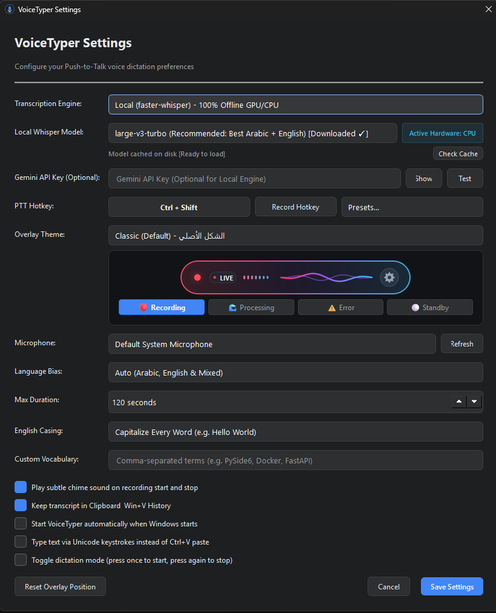

# VoiceTyper 🎙️

**أداة كتابة سريعة وخفيفة لنظام Windows لتحويل الصوت إلى نصوص فوراً بمجرد الكلام (Push-to-Talk).**

تحدث بـ **العامية المصرية، اللغة العربية الفصحى، أو الإنجليزية** (أو ميكس بينهما مثل مصطلحات البرمجة والتكنولوجيا)، وسيقوم VoiceTyper بكتابة كلامك فوراً في أي برنامج تستخدمه (VS Code, Word, Chrome, WhatsApp, وغيرها) **محلياً 100% وبدون الحاجة إلى إنترنت**!

---

## ⚡ كيف تستخدم البرنامج في 3 خطوات؟

1. **اضغط على الاختصار:** اضغط مع الاستمرار على `Ctrl + Shift` (أو اضغط ضغطة واحدة إذا فعلت وضع التبديل Toggle).
2. **تحدث بصوتك:** تكلم بأي لغة أو لهجة، وسيظهر شريط أنيق يتفاعل مع نبرة صوتك.
3. **اترك الأزرار:** سيتم تحويل صوتك لنص فوراً وكتابته مكان مؤشر الكتابة تلقائياً!

💡 *للضبط السريع، اضغط على أيقونة الترس ⚙ الموجودة على الشريط العائم لفتح الإعدادات واختيار الميكروفون أو الثيم المفضل.*

---

## 📸 صور البرنامج وشرح مبسط للواجهة

### 1. نافذة الإعدادات (VoiceTyper Settings)
لوحة تحكم سهلة لضبط كل شيء تريده في مكان واحد:



- **Transcription Engine:** اختر التشغيل **المحلي (أوفلاين بدون نت)** عبر Whisper أو السحابي عبر Gemini.
- **Local Whisper Model:** نموذج `large-v3-turbo` (الافتراضي الموصى به) لفهم فائق للعامية المصرية والإنجليزي.
- **PTT Hotkey:** اختصار الكيبورد (الافتراضي `Ctrl + Shift`)، مع إمكانية تغييره بسهولة عبر زر **Record Hotkey**.
- **Overlay Theme:** اختر شكل الشريط المفضل لديك من بين 4 ثيمات أنيقة، مع شاشة معاينة حية بالأسفل لرؤية الشكل فوراً.
- **Microphone & Language:** اختيار الميكروفون وضبط اللغة على `Auto` للتعرف التلقائي على العربي والإنجليزي.
- **Desktop Shortcut 🖥️:** زر لإنشاء وتحديث اختصار البرنامج على سطح المكتب (Desktop) بضغطة واحدة!
- **Keep in Clipboard (Win+V):** يحفظ كل ما تقوله في سجل حافظة ويندوز حتى لا تفقد أي جملة نطقتها.
- **Toggle Dictation Mode:** وضع التبديل (اضغط مرة لبدء التسجيل، واضغط مرة أخرى لإيقافه دون الحاجة للاستمرار بالضغط).

---

### 2. شريط التسجيل العائم (Floating Overlay)
شريط زجاجي خفيف يطفو على الشاشة، لا يسرق تركيز الكتابة ويمكن سحبه لأي مكان:

| الحالة | الشكل | الوصف |
| :--- | :---: | :--- |
| **التسجيل المباشر** |  | يظهر نقطة حمراء نيون وشارة `● LIVE` مع موجات تتفاعل مع صوتك في الوقت الفعلي. |
| **وضع الاستعداد** |  | شريط داكن هادئ غير مشتت للعين أثناء العمل يوضح أن البرنامج جاهز. |
| **تنبيه أو خطأ** |  | إطار تحذيري يوضح السبب (مثل: لم يتم التقاط صوت) مع زر لإعادة المحاولة (⟳). |

---

## 🌟 أهم المميزات

- 🔒 **100% محلي وأوفلاين:** كل المعالجة تتم على جهازك (كارت الشاشة أو المعالج) لضمان الخصوصية وسرعة الاستجابة.
- 🇪🇬 **دعم ممتاز للمصرية والإنجليزي:** يفهم المصطلحات التقنية (مثل: *Python, Windows, GitHub, API*) ويكتبها بالإنجليزية الصحيحة حتى لو كنت تتكلم بالعامية المصرية.
- 🖥️ **سهولة التشغيل من الديسكتوب:** اختصار جاهز على سطح المكتب لفتح البرنامج بضغطة زر.
- 📋 **تكامل مع Win + V:** لا تضيع أي كلمة تنطقها، حتى لو تحركت من حقل الكتابة قبل اكتمال التفريغ.
- 🎨 **4 ثيمات عصرية:** تشمل Classic، Neon Glass، Matte Dynamic Island، و Fluent Mica.

---

## 📥 التحميل والتشغيل السريع (Downloads)

### 1. تشغيل البرنامج مباشرة (جاهز للعمل بدون بايثون):
- يمكنك تحميل النسخة المباشرة **`VoiceTyper-Standalone.exe`** من صفحة **[GitHub Releases](https://github.com/body2005/Voice-typer/releases)**.
- شغل البرنامج، واضغط زر **Desktop Shortcut 🖥️** من الإعدادات لإنشاء اختصار دائم على سطح المكتب!

### 2. التشغيل من السورس كود (للمطورين):
```powershell
# 1. الدخول للمجلد وإنشاء البيئة الافتراضية
cd "D:\Git Hub\Voice typer"
python -m venv .venv
.\.venv\Scripts\Activate.ps1

# 2. تثبيت المكتبات
pip install -r requirements.txt

# 3. تشغيل البرنامج
python main.py
```

---

## ❓ أسئلة شائعة (FAQ)

<details>
<summary><b>1. أين أجد ملفات التشغيل التنفيذية (.exe) على GitHub؟</b></summary>
تمنع سياسة GitHub رفع أي ملف حجمه أكبر من 100 ميجابايت ضمن أكواد المستودع العادية (وملف البرنامج حجمه حوالي 190 ميجابايت). لذلك يتم وضع البرامج التنفيذية في صفحة <a href="https://github.com/body2005/Voice-typer/releases"><b>GitHub Releases</b></a> المخصصة للتحميل المباشر.
</details>

<details>
<summary><b>2. لماذا لم يتم رفع مجلد `.venv` أو مجلدات الكاش على GitHub؟</b></summary>
مجلد <code>.venv</code> يحتوي على مكتبات بايثون المحلية الخاصة بجهازك فقط ومساراته ثابتة (وحجمه يتجاوز 4 جيجابايت)، ورفعه يجعل المستودع ثقيلاً جداً ولا يعمل على أجهزة أخرى. طبقاً لأفضل ممارسات البرمجة عالمياً، يتم استثناؤه في ملف <code>.gitignore</code>، وتوفير ملف <code>requirements.txt</code> الذي يسمح بتثبيت نفس المكتبات على أي جهاز بثوانٍ. أكواد المشروع وتصاميمه واختباراته بنسبة 100% مرفوعة بالكامل على المستودع.
</details>

<details>
<summary><b>3. كيف أضع البرنامج على سطح المكتب (Desktop)؟</b></summary>
تم وضع اختصار للبرنامج تلقائياً على سطح المكتب لديك باسم <b>VoiceTyper</b>، كما يمكنك دائماً من داخل نافذة الإعدادات بالبرنامج الضغط على زر <b>Desktop Shortcut 🖥️</b> لإنشاء أو تجديد الاختصار فوراً.
</details>

---

## 📄 الترخيص (License)
MIT License. صُمم وطُوّر لتقديم تجربة إملاء صوتي استثنائية وسريعة على نظام ويندوز.
