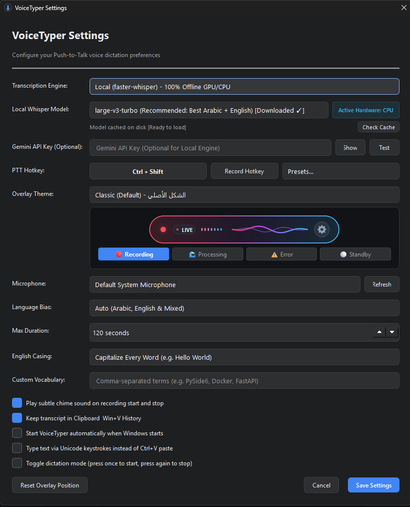

# دليل برنامج VoiceTyper 🎙️

**أداة إملاء صوتي فورية وخفيفة لنظام ويندوز 10 و 11 تعمل بالكامل بدون إنترنت.**

---

## ⚡ كيف تبدأ في 30 ثانية؟

1. **الاختصار:** اضغط على `Ctrl + Shift` واستمر بالضغط (أو اضغط مرة واحدة إذا كنت في وضع التبديل Toggle).
2. **تكلم:** انطق ما تريد بالعامية المصرية أو الفصحى أو الإنجليزية (وحتى المصطلحات التقنية المعقدة).
3. **انتهى:** ارفع يدك عن الأزرار؛ سيتم كتابة كلامك في نفس اللحظة داخل أي برنامج أو محرر نصوص مفتوح!

---

## 🖥️ وضع البرنامج على سطح المكتب (Desktop)

- تم إنشاء اختصار للبرنامج جاهز على سطح المكتب لديك: **`VoiceTyper.lnk`**.
- كما يمكنك في أي وقت فتح إعدادات البرنامج والضغط على زر **`Desktop Shortcut 🖥️`** لإنشاء الاختصار أو تحديثه تلقائياً.

---

## 📸 نظرة سريعة على الواجهة

### 1. نافذة الإعدادات (Settings)

- **Transcription Engine:** اختيار المحرك المحلي `faster-whisper` (بدون نت) أو السحابي `Gemini`.
- **Local Whisper Model:** النموذج المقترح `large-v3-turbo` لسرعة ودقة فائقة.
- **PTT Hotkey:** لتغيير زر التسجيل بزر واحد أو مجموعة أزرار عبر `Record Hotkey`.
- **Overlay Theme:** اختيار الثيم ومعاينته بشكل حي في الصندوق التفاعلي.
- **Desktop Shortcut 🖥️:** زر سريع لتثبيت البرنامج على سطح المكتب.
- **Keep in Clipboard (Win+V):** حفظ النصوص تلقائياً في سجل ويندوز حتى لا تفقد أي كلام.
- **Toggle dictation mode:** التسجيل بضغطة واحدة بدلاً من الاستمرار بالضغط.

---

### 2. حالات الشريط العائم (Overlay)

| الحالة | المعاينة | الوصف |
| :---: | :---: | :--- |
| **التسجيل** |  | نبض أحمر نيون مع شارة `● LIVE` وإكولايزر صوتي يتفاعل مع نبرة صوتك. |
| **الاستعداد** |  | تصميم داكن هادئ لا يشتت الانتباه ويوضح أن البرنامج جاهز. |
| **تنبيه** |  | إطار تحذيري يوضح السبب (مثل: لم يتم التقاط صوت) مع زر لإعادة المحاولة (⟳). |

---

## 📥 تحميل البرنامج (Releases)

- يمكنك تحميل أحدث إصدار تنفيذي جاهز للعمل مباشرة دون الحاجة لتثبيت بايثون من صفحة:
  🔗 **[إصدارات VoiceTyper على GitHub (Releases)](https://github.com/body2005/Voice-typer/releases/tag/v1.0.0)**
  (حمل ملف `VoiceTyper-Standalone.exe` وشغله مباشرة).

---

## ❓ لماذا لا تظهر بعض المجلدات في صفحة الأكواد الرئيسية على GitHub؟

1. **ملفات البرامج التنفيذية (`.exe`):**
   - منصة GitHub تمنع رفع أي ملف يتجاوز حجمه **100 ميجابايت** ضمن الأكواد العادية (ملف البرنامج حجمه حوالي 190 ميجابايت).
   - الحل المعتمد في كل مشاريع GitHub هو رفع الملفات التنفيذية في صفحة **[Releases](https://github.com/body2005/Voice-typer/releases)**، وقد قمنا برفع `VoiceTyper-Standalone.exe` هناك بالفعل.

2. **مجلد البيئة الافتراضية (`.venv`) ومجلدات الكاش (`build/` و `__pycache__/`):**
   - مجلد `.venv` يتجاوز حجمه **4 جيجابايت** ويحتوي على مكتبات بايثون المحلية الخاصة بجهازك فقط.
   - في جميع مشاريع البرمجة العالمية، يتم استبعادها في ملف `.gitignore` لأنها تُثقل المستودع ولا تعمل على أجهزة أخرى، وبدلاً منها يتم رفع ملف `requirements.txt` لتثبيتها على أي جهاز بدقيقة واحدة.
   - **جميع أكواد وتصاميم وأصول واختبارات المشروع مرفوعة بنسبة 100%.**
